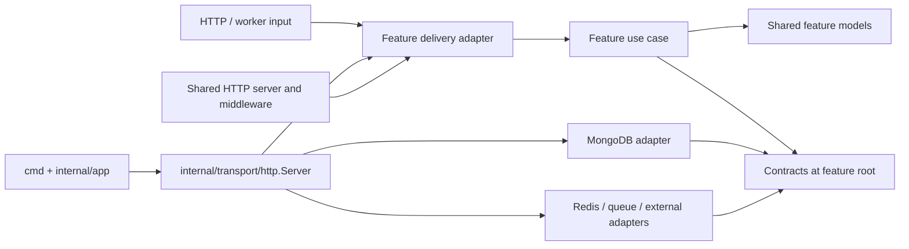

# Architecture

## Purpose and status

`go-backend` is the Go implementation of Bento's backend. The existing NestJS application under `backend/` is the reference for business behavior and external contracts. Its framework modules are not copied one-for-one as Go packages.

The current Go repository has a feature-oriented `internal/features` tree and separate process, transport, configuration, infrastructure, migration, and shared-package areas. The API wires the first migration slice: Google sign-in, RS256 sessions, MongoDB users, HTTP middleware, and observability. Other feature directories remain scaffolds. The rules below describe the target boundaries as that work proceeds.

## Dependency direction

Feature contracts live at the feature root, while implementations stay in their responsibility folders. HTTP routes call handlers, handlers call use cases, and use cases call repository interfaces. The composition code builds the concrete repository, use case, and handler in that order and then registers feature routes.



The diagram shows source-code dependencies, not a required runtime call order. The composition root constructs concrete adapters and injects them into use cases. Avoid service locators, package-level mutable clients, and feature-to-feature imports that expose another feature's persistence details.

## Responsibilities

| Area | Responsibility | Must not own |
| --- | --- | --- |
| `cmd/<process>` | Process entry point and signal handling | Business rules or database queries |
| `internal/app` | Process composition: initialize shared clients and observability, then delegate HTTP setup and lifecycle | Feature behavior or endpoint registration |
| `internal/models` | Shared persisted, request/response, and token models, named `<feature>_model.go` | Feature workflows or HTTP route registration |
| `internal/features/<feature>` | Feature interfaces and package boundary | Business logic implementations or shared client lifecycle |
| `internal/features/<feature>/domain` | Feature-owned business errors and rules/normalization that do not belong to transport or storage | HTTP status codes, database queries, or shared data models |
| `internal/features/<feature>/usecase` | Application workflow implementations | Echo handlers, route definitions, or concrete database clients |
| `internal/features/<feature>/delivery` | Feature-specific inbound adapters, such as HTTP handlers or worker consumers | Route definitions, business rules, or persistence implementation |
| `internal/features/<feature>/repository` | Feature-specific persistence and outbound adapters | Shared client lifecycle |
| `internal/transport/http` | Echo server, feature dependency wiring, route-group creation, HTTP lifecycle, shared middleware, and error/response mapping | Feature-specific business rules |
| `internal/infrastructure` | Shared client construction and vendor integrations (MongoDB, Redis, RPC, AI, blockchain, observability) | Feature workflows and models |
| `pkg/<name>` | A small, stable, deliberately reusable package with no feature ownership | Application wiring or a catch-all `utils` API |
| `config` | Configuration schema and loading | Runtime client construction |

Feature contracts are declared at the feature root, one interface per file: `usecase.go`, `mongo_repository.go`, and `delivery.go` where applicable. Add another root-level contract file only when a separate dependency needs its own interface. Implementations go in subfolders. Endpoint paths and route registration live in `delivery/http/routes.go`; request parsing and response mapping live in `delivery/http/handlers.go`.

Only add a feature subdirectory when that feature needs it. The intended feature shape is not a requirement to create empty folders preemptively:

```text
internal/features/<feature>/
  usecase.go               # Usecase interface
  mongo_repository.go      # MongoRepository interface, when persisted in MongoDB
  delivery.go              # Handlers interface, when it has HTTP input
  domain/                   # Feature-owned business errors and rules, when needed
  usecase/                  # workflow implementation
  delivery/http/            # handlers.go and routes.go when it has HTTP input
  repository/mongodb/       # MongoDB implementation
```

`internal/infrastructure/mongodb` owns the shared MongoDB client and lifecycle. A feature repository owns its collection operations and BSON mapping, and implements the feature-root repository contract. `internal/transport/http` owns server-wide concerns; feature-specific handlers can live with their feature so a future service extraction has a clear starting boundary.

## Scaling into services

Keep each feature's use cases and feature-specific adapters together. Put shared data shapes in `internal/models/<feature>_model.go`. Keep feature-owned errors and business rules in that feature's `domain/` folder when those files are needed; `domain` is just the home for those rules, not another model layer that every feature must implement. Keep the feature root for interfaces only. Cross-feature calls should go through a small exported use-case API, not another feature's repository. If a workflow must become asynchronous or cross a process boundary, define the message/API contract at that boundary and move the adapter with the feature that owns the behavior.

This structure makes extraction easier, but does not itself make a feature an independent service. A service split also requires an owned data boundary, deployment/runtime configuration, observability, and a stable communication contract. Do not create a network call between features while they still run in one process unless there is a concrete operational need.

## Database direction

MongoDB is the target persistence store for new feature repositories. The shared MongoDB client and Google user repository are implemented; the migration directory still has a placeholder and there is no general migration runner yet. PostgreSQL is declared in configuration and has a migration placeholder. New work should not choose PostgreSQL implicitly; document any PostgreSQL use as an explicit compatibility or migration requirement.

See [Data and storage](data-and-storage.md) for repository and schema rules.
