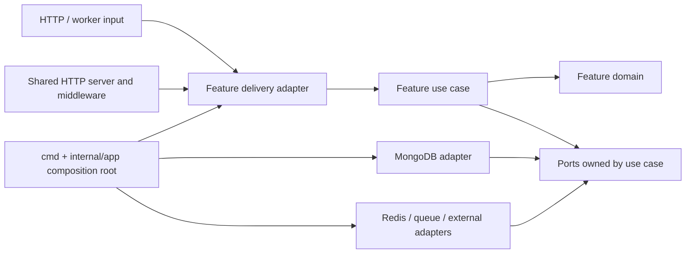

# Architecture

## Purpose and status

`go-backend` is the Go implementation of Bento's backend. The existing NestJS application under `backend/` is the reference for business behavior and external contracts. Its framework modules are not copied one-for-one as Go packages.

The current Go repository has a feature-oriented `internal/features` tree and separate process, transport, configuration, infrastructure, migration, and shared-package areas. Most feature files and the API composition root are still empty. The rules below are the target for implementation; they do not claim that those layers are already wired together.

## Dependency direction

The dependency rule is inward: transport and persistence adapters depend on application use cases; use cases depend on domain types and ports; domain code has no dependency on HTTP, MongoDB, Echo, Redis, or vendor SDKs.



The diagram shows source-code dependencies, not a required runtime call order. The composition root constructs concrete adapters and injects them into use cases. Avoid service locators, package-level mutable clients, and feature-to-feature imports that expose another feature's persistence details.

## Responsibilities

| Area | Responsibility | Must not own |
| --- | --- | --- |
| `cmd/<process>` | Process entry point and signal handling | Business rules or database queries |
| `internal/app` | Composition root: load config, create clients, wire adapters, start and stop processes | Feature behavior |
| `internal/features/<feature>/domain` | Business entities, value types, invariants, and domain errors | HTTP status codes, BSON documents, SDK types |
| `internal/features/<feature>/usecase` | Application workflows, input/output models, and ports required by those workflows | Echo handlers or concrete database clients |
| `internal/features/<feature>/delivery` | Feature-specific inbound adapters, such as HTTP handlers or worker consumers | Domain decisions or persistence implementation |
| `internal/features/<feature>/repository` | Feature-specific persistence and outbound adapters | Shared client lifecycle |
| `internal/transport/http` | Echo server setup, shared HTTP middleware, and HTTP error/response mapping | Feature-specific business logic |
| `internal/infrastructure` | Shared client construction and vendor integrations (MongoDB, Redis, RPC, AI, blockchain, observability) | Feature workflows and domain models |
| `pkg/<name>` | A small, stable, deliberately reusable package with no feature ownership | Application wiring or a catch-all `utils` API |
| `config` | Configuration schema and loading | Runtime client construction |

Only add a feature subdirectory when that feature needs it. The intended feature shape is not a requirement to create empty folders preemptively:

```text
internal/features/<feature>/
  domain/
  usecase/
  delivery/http/          # when the feature has HTTP input
  repository/mongodb/     # when the feature persists data in MongoDB
```

`internal/infrastructure/mongodb` owns the shared MongoDB client and lifecycle. A feature repository owns its collection operations, BSON mapping, and implementation of a use case port. `internal/transport/http` owns server-wide concerns; feature-specific handlers can live with their feature so a future service extraction has a clear starting boundary.

## Scaling into services

Keep each feature's domain, use cases, and feature-specific adapters together. Cross-feature calls should go through a small exported use-case API or an explicit port, not another feature's repository. If a workflow must become asynchronous or cross a process boundary, define the message/API contract at that boundary and move the adapter with the feature that owns the behavior.

This structure makes extraction easier, but does not itself make a feature an independent service. A service split also requires an owned data boundary, deployment/runtime configuration, observability, and a stable communication contract. Do not create a network call between features while they still run in one process unless there is a concrete operational need.

## Database direction

MongoDB is the target persistence store for new feature repositories. The repository currently has a MongoDB connection scaffold and a MongoDB migrations directory, but both are empty, and `go.mod` does not yet include the MongoDB Go driver. PostgreSQL is also declared in configuration and has a migration placeholder. New work should not choose PostgreSQL implicitly; document any PostgreSQL use as an explicit compatibility or migration requirement.

See [Data and storage](data-and-storage.md) for repository and schema rules.
